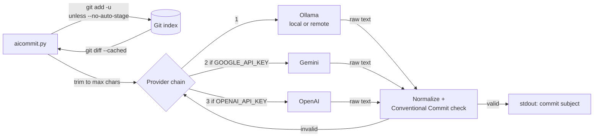

# aicommit

Generate a Conventional Commit subject line from your staged Git changes using an LLM (Ollama, Gemini or OpenAI).

## Overview

`aicommit` is a single-file Python CLI for developers who want a reasonable commit message without writing it by hand.
It reads the staged diff, asks an AI provider for one commit subject, cleans up the model's output and validates it
against the Conventional Commits format. Only the final subject is printed to stdout, so it composes with
`git commit -m "$(...)"` and Git aliases.

## Features

- Reads the staged diff (`git diff --cached`), optionally one file at a time (`--diff-per-file`).
- Auto-stages tracked changes with `git add -u` before reading the diff (disable with `--no-auto-stage`).
- Provider fallback chain `ollama -> gemini -> openai`; Gemini and OpenAI join the chain only when their API key is
  set. `--provider` forces a single one.
- Ollama model fallback: if the requested model is not installed, it tries other tags of the same base model, then
  the best-ranked locally installed models.
- Normalizes noisy model output (code fences, bullets, quotes, `Commit message:`-style prefixes).
- Enforces Conventional Commits by default; `--allow-nonconventional` turns that off.
- Trims very large diffs (default 14,000 characters) by keeping the head and tail, to keep prompts reliable.
- Writes the subject in any language (`--language es`).
- Distinct exit codes for Git errors, provider errors and validation failures.

## How it works



Each provider is tried in order; the first one that returns a valid subject wins. If every provider fails or returns a
non-conventional message, the error list is printed to stderr.

## Requirements

- Python 3.9+
- Git
- At least one provider:
  - an Ollama server (default `http://127.0.0.1:11434`), or
  - a Gemini API key, or
  - an OpenAI API key.

## Installation and quick start

```bash
git clone https://github.com/Lapeyus/aicommit.git
cd aicommit
python3 -m venv .venv
source .venv/bin/activate
pip install -r requirements.txt

# inside any Git repository with changes:
python3 /path/to/aicommit/aicommit.py
git commit -m "$(python3 /path/to/aicommit/aicommit.py)"
```

`ollama`, `google-generativeai` and `openai` are imported lazily: if one is missing, only that provider is skipped.
`python-dotenv` is required.

## Usage

```text
usage: aicommit.py [-h] [--provider {ollama,gemini,openai}] [--language LANGUAGE]
                   [--allow-nonconventional] [--diff-per-file]
                   [--max-diff-chars MAX_DIFF_CHARS] [--no-auto-stage] [--debug]
```

| Flag | Effect |
|---|---|
| `--provider {ollama,gemini,openai}` | Use only this provider instead of the fallback chain |
| `--language LANGUAGE` | Language for the subject (default `en`) |
| `--allow-nonconventional` | Accept output that does not match Conventional Commits |
| `--diff-per-file` | Build the prompt by concatenating per-file diffs |
| `--max-diff-chars N` | Maximum diff size sent to the model; `0` disables trimming |
| `--no-auto-stage` | Do not run `git add -u` first |
| `--debug` | Log provider attempts and trimming to stderr |

Examples:

```bash
python3 aicommit.py --provider openai        # force OpenAI
python3 aicommit.py --language es            # Spanish subject
python3 aicommit.py --no-auto-stage          # only what you staged yourself
python3 aicommit.py --allow-nonconventional  # free-form subject
```

### Git aliases

```bash
# print a message
git config --global alias.aimsg '!python3 /absolute/path/to/aicommit.py'

# commit with the generated message
git config --global alias.ai '!f(){ msg="$(python3 /absolute/path/to/aicommit.py)" || exit $?; git commit -m "$msg"; }; f'
```

### Conventional Commit rules

Allowed types: `feat`, `fix`, `docs`, `style`, `refactor`, `test`, `chore`, `build`, `ci`, `perf`, `revert`.
Accepted shapes: `type: subject`, `type(scope): subject`, `type(scope)!: subject`.

### Exit codes

| Code | Meaning |
|---|---|
| `0` | Success; subject printed to stdout |
| `1` | Git error: not a repository, `git add -u` failed, or no staged diff |
| `2` | Generation error: provider failure, empty output, or negative `--max-diff-chars` |
| `3` | Output failed Conventional Commit validation |

## Repository layout

```text
.
├── aicommit.py        # the whole CLI: config, providers, output normalization, Git helpers, main()
├── requirements.txt   # provider SDKs + python-dotenv
├── LICENSE            # Apache License 2.0
└── .gitignore
```

## Configuration

Environment variables (a `.env` file in the working directory is loaded via `python-dotenv`; keep it out of Git):

| Variable | Default | Description |
|---|---|---|
| `OLLAMA_HOST` | `http://127.0.0.1:11434` | Ollama server URL |
| `OLLAMA_MODEL_NAME` | `gemma3n:e4b` | Preferred Ollama model |
| `GOOGLE_API_KEY` | _empty_ | Gemini API key (enables Gemini) |
| `GEMINI_MODEL_NAME` | `gemini-2.0-flash` | Gemini model |
| `OPENAI_API_KEY` | _empty_ | OpenAI API key (enables OpenAI) |
| `OPENAI_MODEL_NAME` | `gpt-3.5-turbo-0125` | OpenAI model |
| `AICOMMIT_MAX_DIFF_CHARS` | `14000` | Default for `--max-diff-chars` |

## Tests

There is no automated test suite. Manual smoke checks: `python3 aicommit.py --help` prints usage, and running it
outside a Git repository exits with code `1` and `not a git repository`.

## Troubleshooting

- `not a git repository`: run it inside a Git worktree.
- `no staged diff`: stage changes first, or keep the default auto-stage (`git add -u`, which only picks up tracked
  files; new files must be added by hand).
- `forced provider 'X' unavailable or misconfigured`: set that provider's API key and model.
- `not conventional: ...`: rerun, or pass `--allow-nonconventional` on purpose.

## Project status

Personal tool, maintained occasionally. Created February 2024; last change 11 February 2026 (CLI hardening and
Conventional Commit validation).

### Known limitations

- Produces a subject line only, never a commit body.
- Gemini support uses the legacy `google-generativeai` SDK pinned at `0.3.1`; the pinned `openai==1.11.1` and
  `gpt-3.5-turbo-0125` default are also dated.
- `requirements.txt` lists `inquirer`, which the current code does not use.
- Auto-staging with `git add -u` means running the tool stages every modified tracked file, which may be more than
  you intended to commit.
- Diff trimming keeps the first and last halves of the budget and drops the middle; changes in the dropped part are
  invisible to the model.

## License

Apache License 2.0. See [LICENSE](LICENSE).
